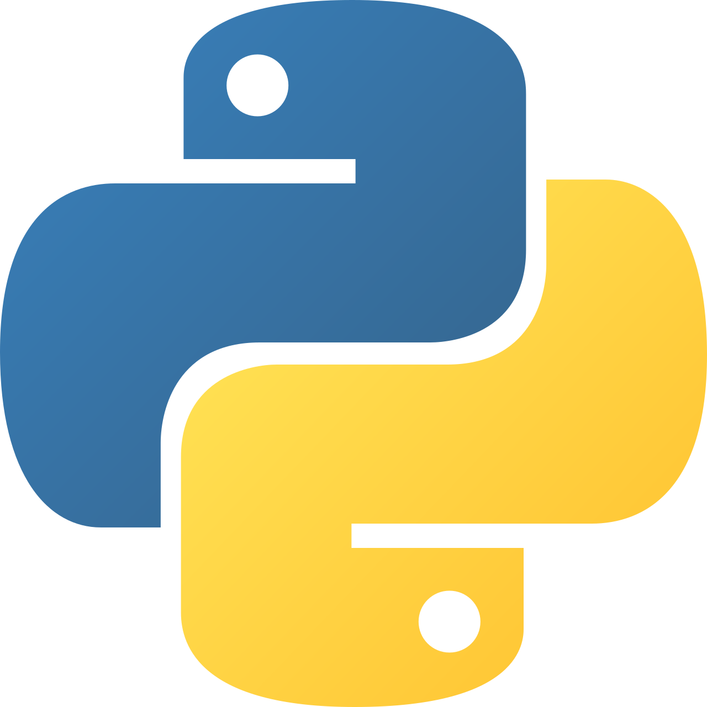
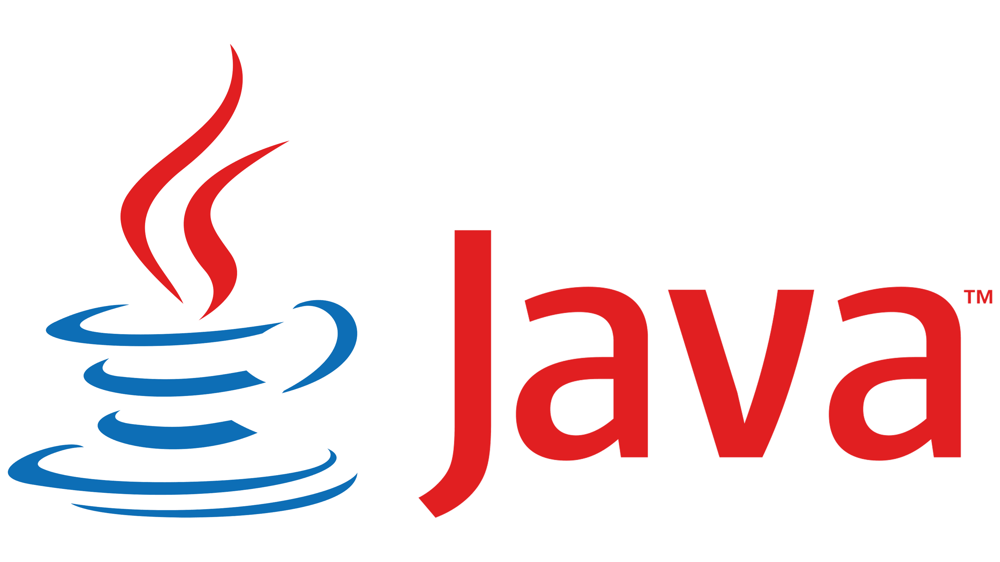
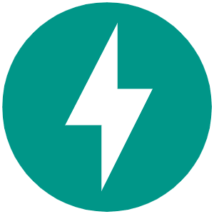
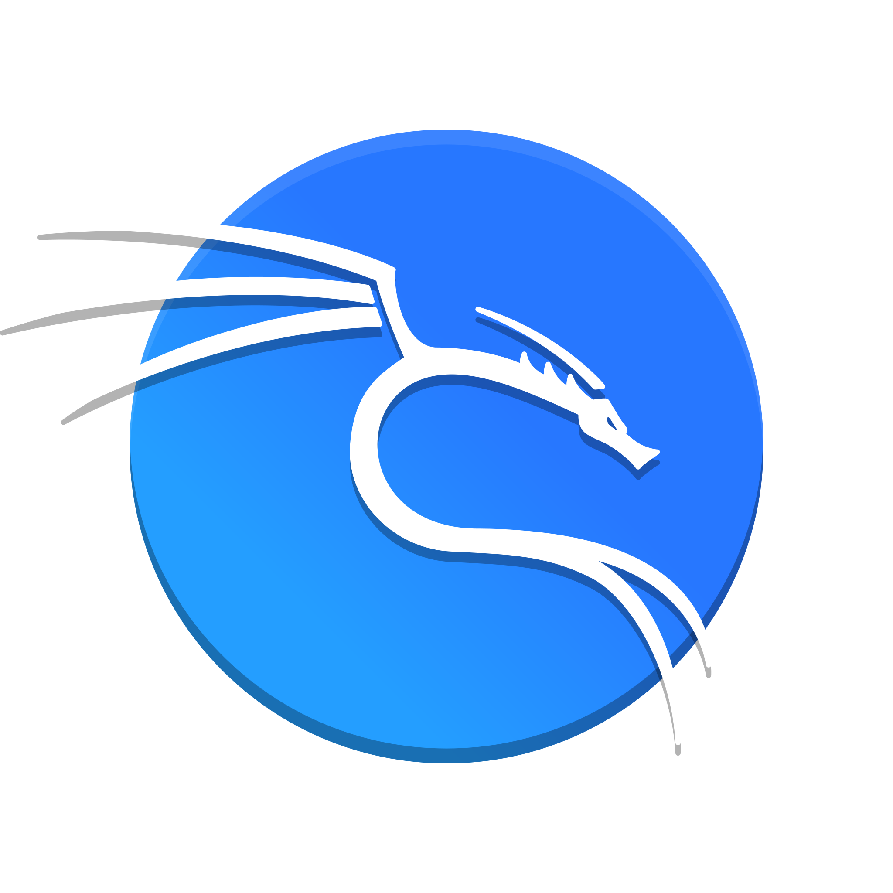
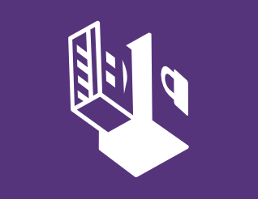
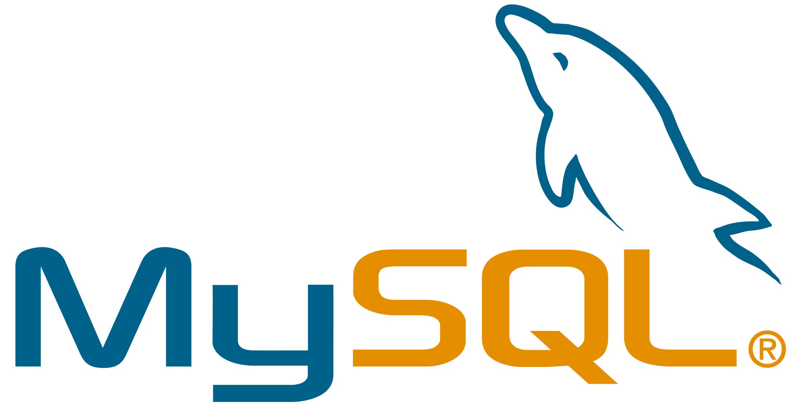
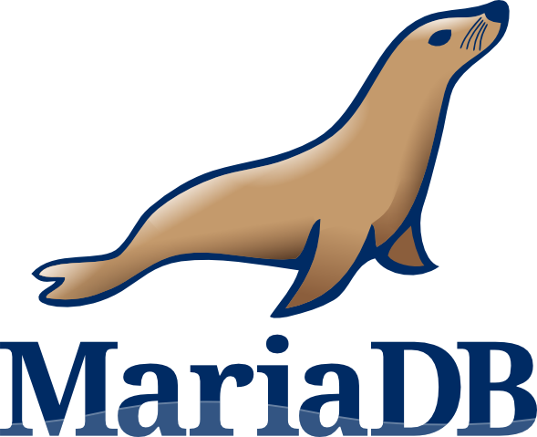
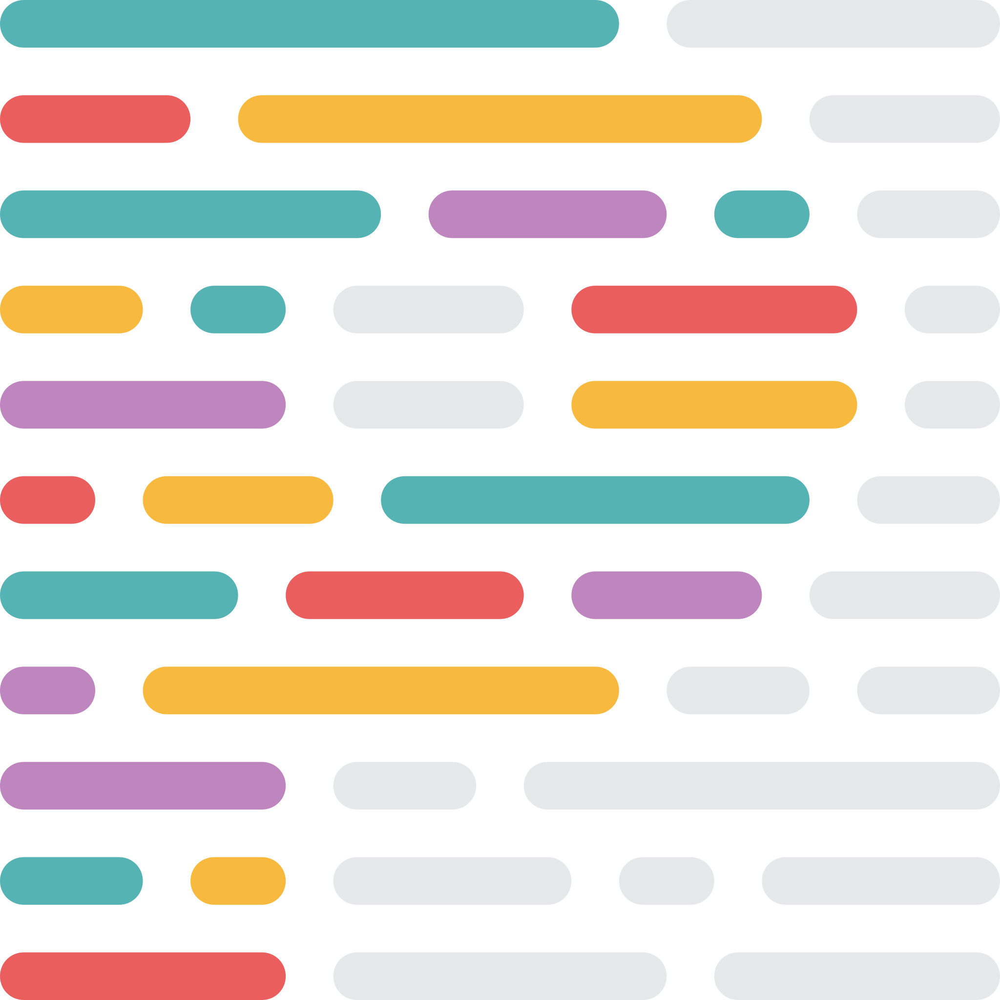

  

  

  
  

Com sólida formação acadêmica em tecnologia, incluindo Graduação em Análise e Desenvolvimento de Sistemas, pós-graduações em Segurança da Informação e Data Science & Big Data, e MBA em Inteligência Artificial, atuo como desenvolvedor com foco em soluções inteligentes e seguras.

Minha experiência integra desenvolvimento de software, análise de dados e cibersegurança, com ênfase na criação de soluções robustas para identificação de vulnerabilidades, monitoramento e tomada de decisão orientada por dados.

A combinação entre Inteligência Artificial e Data Science amplia minha capacidade de atuar de forma estratégica, aplicando tecnologia para gerar valor real, eficiência operacional e fortalecimento da segurança organizacional.

Busco oportunidades desafiadoras onde possa aplicar conhecimentos técnicos e visão analítica para impulsionar a transformação digital e elevar o nível de maturidade tecnológica das organizações.

##  Habilidades Técnicas e Ferramentas

<table align="center">
<tr>
<td>

| **Categoria** | **Tecnologias** |
|----------------|-----------------|
| **Linguagens / Frameworks** |          |
| **Frontend / Web** |     |
| **Segurança / Redes / OS** |      |
| **Banco de Dados** |    |
| **Ferramentas / IDEs** |       |
| **Estudando Atualmente** |     |

</td>
</tr>
</table>

## Certificações

## Projetos de Destaque

Meus projetos demonstram a aplicação prática de conceitos de cibersegurança e desenvolvimento de ferramentas:

### Guias e Material Educacional

| Projeto | Descrição | Link |
|---|---|---|
| **linux-security-guide** | Guia prático de Linux para Cibersegurança — fundamentos, redes, hardening e labs práticos. Criado e testado em sala de aula no SENAI. | [linux-security-guide](https://github.com/MMVonnSeek/linux-security-guide) |
| **linux-hardening-toolkit** | Auditoria e hardening automatizado de servidores Linux, score de segurança baseado no CIS Benchmark, relatório HTML e correções interativas. | [linux-hardening-toolkit](https://github.com/MMVonnSeek/linux-hardening-toolkit) |

### Ferramentas de Reconhecimento (Reconnaissance)

| Projeto | Habilidade Demonstrada | Link |
|---|---|---|
| **Port Scanner** | Proficiência em **programação de rede** e **análise de protocolos** para identificação de vulnerabilidades. | [Port-Scanner](https://github.com/MMVonnSeek/Port-Scanner) |
| **Subdomain Enumerator** | Framework avançado de enumeração de subdomínios com técnicas ativas e passivas, DoH, APIs de Recon, paralelismo, dashboard HTML e logging estruturado. | [Subdomain-Enumerator](https://github.com/MMVonnSeek/Subdomain-Enumerator) |
| **Whois-ip-recon** | Ferramenta de reconhecimento passivo que agrega informações de Whois, inteligência de IP e dados OSINT. | [whois-ip-recon](https://github.com/MMVonnSeek/whois-ip-recon) |

### Ferramentas de Análise e Automação

| Projeto | Habilidade Demonstrada | Link |
|---|---|---|
| **Passcheck-pro** | Análise avançada de senhas com múltiplas heurísticas — entropia, padrões de teclado e contexto pessoal. | [passcheck-pro](https://github.com/MMVonnSeek/passcheck-pro) |
| **Firewall-Detector** | Ferramenta de **segurança de rede** que analisa o comportamento de pacotes para detectar a presença de firewalls. | [Firewall-Detector](https://github.com/MMVonnSeek/Firewall-Detector) |
| **PyKeyMonitor** | Desenvolvimento de ferramenta de **monitoramento** e **análise forense** (keylogger ético) em Python. | [PyKeyMonitor](https://github.com/MMVonnSeek/PyKeyMonitor) |

### Segurança Ofensiva e CTF

| Projeto | Habilidade Demonstrada | Link |
|---|---|---|
| **CTF-Tools-Educacional** | Conhecimento em diversas disciplinas de CTF, como **forense** e **web exploitation**. | [CTF-Tools-Educacional](https://github.com/MMVonnSeek/CTF-Tools-Educacional) |
| **Esteganografia** | Aplicação de técnicas de **criptografia** e **ocultação de dados** (Segurança da Informação). | [Esteganografia](https://github.com/MMVonnSeek/Esteganografia) |

  

  
<!-- ========================== -->
<!-- 📊 Estatísticas -->
<!-- ========================== -->
### 📊 Estatísticas 
  

    
<b>MMVonnSeek</b>

<h2 align="center"> Minhas Estatísticas no GitHub</h2>

  

  
  

  

##  Conexão e Contato

Interessado em minhas habilidades e projetos? Conecte-se comigo!
  
----
  

